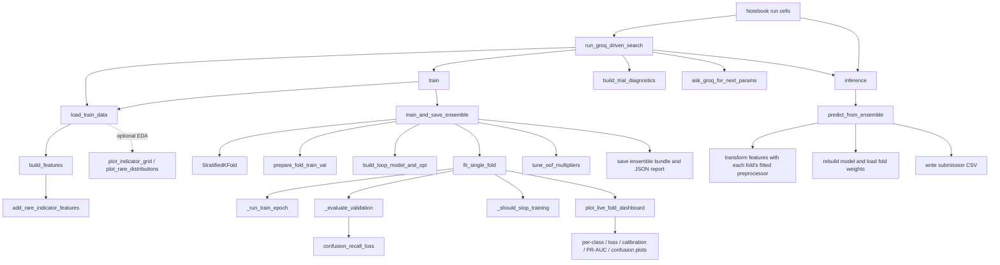

# Notebook structure and cleanup guide

This note documents the current `CECS550ArithmiaCompNotebook.ipynb` pipeline, its function-call hierarchy, and cleanup candidates. It is intentionally separate from the notebook so the existing experiment results and saved cell outputs are not overwritten.

## Function-call hierarchy

## Data flow

```mermaid
flowchart LR
    TRAINCSV[Train.csv: ID, features, Rhythm] --> LOAD[load_train_data]
    LOAD --> XRAW[Feature DataFrame X_df]
    LOAD --> YRAW[Labels y_raw]
    XRAW --> FEAT[build_features]
    FEAT --> X[Engineered feature table]
    YRAW --> ENC[LabelEncoder]
    X --> KF[Stratified 5-fold split]
    ENC --> KF
    KF --> PRE[Fit scaler on fold train only; pass indicators through]
    PRE --> DL[Weighted sampled training DataLoader]
    DL --> NET[DeepFeedbackLoopResNet]
    NET --> VAL[Validation probabilities and metrics]
    VAL --> CKPT[Select best fold checkpoint]
    CKPT --> OOF[Out-of-fold probabilities]
    OOF --> MULT[Tune per-class probability multipliers]
    MULT --> BUNDLE[.pt bundle: weights, scalers, feature names, classes, multipliers, params]
    BUNDLE --> TEST[Test.csv]
    TEST --> FEAT
    FEAT --> PRED[Average fold probabilities, apply multipliers]
    BUNDLE --> PRED
    PRED --> SUB[submission.csv]
```

`prepare_fold_train_val` fits preprocessing on the training portion of a fold and applies that fitted transform to validation data. Inference likewise uses the stored fold preprocessor; it should not fit a new scaler on test data. The held-out test labels are not part of this flow.

## Cleanup candidates

The notebook contains several generations of helpers in separate code cells. Before removing any definition, search the full notebook for references and retain a regression check for the training and inference paths.

| Candidate | Reason | Safe cleanup approach |
|---|---|---|
| `prepare_fold_data` | Older fold-preparation implementation; the later training path calls `prepare_fold_train_val`. | Remove only after confirming there are no direct/manual notebook calls to the older helper. Keep the active helper's train-only-fit behavior. |
| `augment_rare_anchors` | Explicitly marked deprecated/synthetic data augmentation; the active training path uses weighted sampling and class-cost loss instead. | Remove if no experiment cell calls it; otherwise preserve as a clearly labeled legacy experiment. |
| `print_pr_auc_report` | Explicitly marked deprecated; PR-AUC is computed by the current validation/dashboard/report paths. | Remove if no remaining calls exist. |
| Earlier `print_stop_reason` | A later definition supersedes the earlier one and has a different signature. In a notebook, the later definition silently replaces the earlier binding. | Keep one implementation and update all call sites to the retained signature. |
| `plot_dashboard_legend` alias | Alias of `print_dashboard_legend`; aliases add indirection if no caller needs the alternate name. | Keep only the canonical name after checking references. |
| `plot_dashboard_legend` / `print_dashboard_legend` implementation | A dashboard legend is presentation-only and not part of training or inference. | Keep it only if the optional dashboard is used; otherwise remove it along with its call. |
| Kaggle starter/template cell and one-off Groq connectivity/model-list checks | Environment setup or manual diagnostics, not reusable model-pipeline functions. | Move to a short setup/optional diagnostics section or remove from the main run path. Do not remove the secret-backed client initialization if Groq search remains enabled. |
| Plot functions | EDA/dashboard helpers are optional and do not produce model inputs. | Group into an optional visualization section; retain plot helpers that are invoked by the enabled EDA or dashboard paths. |

The notebook's helper names and call sites should be rechecked together before deletion; notebook execution order can leave stale definitions in kernel state and make an apparently unused function appear necessary (or vice versa).

## Suggested concise notebook sections

1. **Setup and configuration** — imports, paths, device, secrets only when Groq search is enabled.
2. **Data and feature preparation** — `load_train_data`, `build_features`, and the rare-indicator feature helper.
3. **Model and training utilities** — model class, fold preparation, epoch/evaluation/stop helpers, and model/optimizer builder.
4. **Training and evaluation** — fold training, OOF calibration, checkpointing, and an optional dashboard.
5. **Inference** — load bundle, transform test features with saved preprocessors, predict, and write submission.
6. **Optional experiments** — EDA plots and Groq-driven hyperparameter search, separated from the default run path.

Use short docstrings for public pipeline functions to state inputs, outputs, and side effects (especially files written); use inline comments only for non-obvious choices such as train-only scaler fitting, class-weight construction, loop early exits, and OOF multiplier constraints. Avoid repeating section banners that restate the function name.
