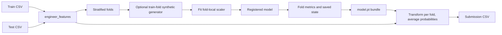

# Modular Python pipeline

The notebook remains unchanged as an experiment record. The maintainable implementation is now organized under `arithmia_comp/`; configuration is passed explicitly, preprocessing is fitted inside each training fold, and each fold's model/preprocessor is stored for inference.

## Quick start

```bash
python run.py train /path/to/Train.csv model.pt --folds 5 --epochs 280 --hidden-dim 40
python run.py predict /path/to/Test.csv model.pt submission.csv
```

Install the notebook's usual dependencies (`numpy`, `pandas`, `scikit-learn`, and `torch`) in the active environment. The data must include the configured ID and target columns (`patient_ID` and `Rhythm` by default) and the ECG columns used by `engineer_features`.

## Design and extension points

- `PipelineConfig` exposes fold count, model name, architecture, optimizer, sampling, regularization, and device settings. Pass an instance to `fit_ensemble`; CLI flags are a convenience, not the only configuration interface.
- `MODEL_REGISTRY` in `arithmia_comp/model.py` maps names to model factories. A future ensemble can select multiple registered families without coupling model choice to the fold loop.
- `fit_ensemble(..., synthetic_generator=...)` accepts an optional callable `(train_features, train_labels) -> (features, labels)`. It runs only on each fold's training rows, before fitting that fold's scaler; validation rows are never augmented.
- `search_history.py` provides atomic trial persistence, best-parameter resume, bounded parameter sanitization, and compact prompt context. It is intentionally not coupled to Groq or the training pipeline; a search driver can pass fold metrics and a proposal callback without changing training functions.

## Main data flow



This compact implementation focuses on reusable training and inference. Optional exploratory plots and the old LLM client connectivity checks are excluded from the default path. No pretrained model or clinical interpretation is implied.
